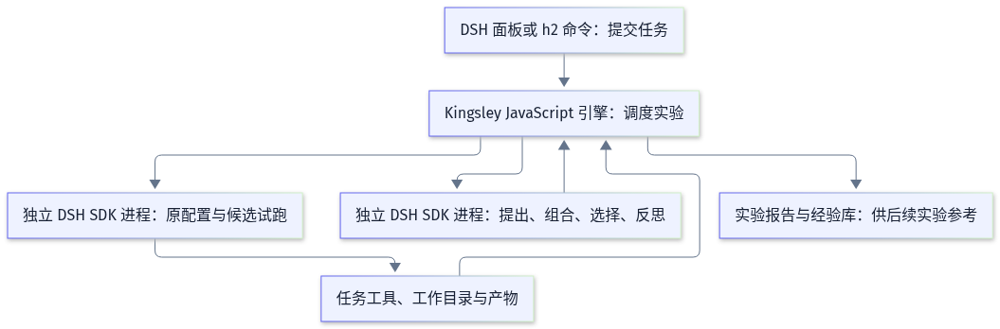

# Kingsley Harness² 插件与当前 DSH 的兼容性分析

核查日期：2026-10-27，Asia/Shanghai。

## 当前判断

Kingsley 的 `dsh-plugin-harness2` 确实使用独立的 DeepSeek Harness SDK 进程执行任务。参考执行、候选试跑和组合执行都有真实模型请求、工具动作和产物记录。它符合“由 DSH 承担执行端”的方向，但采用 JavaScript 自行实现优化流程，没有调用 Google 原版 Harness² 核心。[执行器][k-runner]、[实验引擎][k-engine]

**发布版 0.2.0 不能原样使用我们当前的 DSH 0.2.1-rc.3 执行实验。** 执行器只接受 `0.2.1-rc.2`。本机无模型探针已复现真实退出码 1，错误为 `Unsupported dsh version 0.2.1-rc.3; this adapter is verified against 0.2.1-rc.2`。[版本检查][k-version]、[探针记录](compatibility-checks.json)

它也不能直接替代本项目已有的学习插件方案。ADR0007 要求复用原版核心，ADR0006、ADR0010 要求项目采用、经验使用控制和学习工作区隔离。Kingsley 的实现与这些决定存在差异。单独评估另一种实验工具，与替换既有项目学习设计，是两个决定。[ADR0007](../../adr/0007-integrate-original-harness2-core.md)、[ADR0006](../../adr/0006-separate-learning-adoption-and-use.md)、[ADR0010](../../adr/0010-isolate-learning-by-workspace.md)

此次没有安装到现役 profile，没有启动付费模型，也没有修改 DSH、Kingsley 或 Google 上游源码。本次分析未修改安装清单、锁文件、服务和启动入口。

## 固定版本与证据

| 对象 | 核查版本 |
|---|---|
| Kingsley 插件 | `0.2.0`，`d9b71bf5e065c8c7c0e8b18e02b25f86d1f42c40` |
| Kingsley GitHub release | `v0.2.0`，2026-10-22 发布，tag 指向上述提交 |
| 发布包 SHA-256 | `730d50affd48a34ed424ea3038ffd7570ec2971928e0de37defa9cd4d1cd09fb` |
| Google Harness² | `1cfe254e8d25b15f37048c3730134686abe60335` |
| 当前工程 | `5c0571a2a7f24df6f652b6778ba624183a8488c8` |
| 工程固定 DSH | `0.2.1-rc.3`，`1f81c047fc48fa190a683e469daa699857e9afe8` |
| 已安装应用中的 DSH / Cordis | `0.2.1-rc.3` / `4.0.5` |
| 本次探针解释器 | 已安装应用的 Node.js `24.12.0` |

实际下载了 GitHub 发布包，摘要与 release 元数据一致。包内 `package.json`、bundle、引擎、执行器、经验库和版本检查文件，均与固定源码逐字节一致。因此，版本限制存在于公开发布包中，并非只存在于未发布主线。[发布版本][k-release]、[发布包核验](release-package.json)、[工程固定版本](../../../dsh-runtime.json)

## 真实任务怎样运行

用户通过 DSH 会话中的 `/h2` 命令或面板提交任务 JSON。插件创建实验快照，再由 JavaScript 引擎调度多个独立的 DSH SDK 进程。每次任务试跑有自己的 home、profile 和工作目录。整个过程不需要 Google Python 优化器。[宿主入口][k-index]、[执行器][k-runner]

默认的 parallel、`k=1` 包含一次原配置执行、两次候选执行和一次组合执行。另有两次提出候选、一次组合和一次反思会话。这里统计的是 Agent 执行次数，一次执行可能包含多次模型和工具调用，不能直接当作 API 请求数。[调度实现][k-schedule]

必须区分绑定来源任务与恢复任务现场：

- `sourceRun.sessionId` 和 `turn` 用于读取原任务的模型参数。
- `task.prompt` 和 `inputDir` 仍需单独提供，插件不会自动恢复原聊天全文和当时文件。
- 默认 baseline 是 `sdk-minimal`，不会自动取得现役 Web 会话的全部插件、工具与模型路由。
- 可以显式指定 baseline 的 profile、sourceHome 和 patches，但需要它们能够提供 SDK 协议。[来源读取][k-source]、[快照创建][k-create]、[profile 捕获][k-freeze]

因此，它提供的是显式任务实验入口。当前实现不能理解为“在任意现役聊天中按一个按钮，就完整复制原 Agent 的现场”。

## 与原版 Harness² 的主要差异

详细逐项源码比较见[算法审计](algorithm-comparison.md)。下表列出影响选型的部分。

| 项目 | Google 原版 | Kingsley 0.2.0 | 实际影响 |
|---|---|---|---|
| 优化核心 | Python 核心和标准适配器契约 | JavaScript 独立引擎 | 原版论文结果不能直接迁移 |
| 执行端 | 发布实现支持 OpenCode、Codex | 独立 DSH SDK 进程 | 真实工具和产物由 DSH 产生 |
| parallel | 正常 `4k` 次任务执行 | 正常 `4k` 次 | 基本拓扑相同 |
| sequential | 正常 `4k` 次任务执行 | 正常 `5k−1` 次 | 第二轮起额外执行当前配置参考，成本更高 |
| 提案与组合 | 编辑真实配置文件，按需读源材料和证据 | 无工具会话返回 JSON，整组件替换 | 编辑器不能主动重查未出现在轨迹中的文件 |
| 最终选择 | 匿名打乱标识，可读源材料及适配器渲染资产 | 顺序编号，只内联回复和修改过的 UTF-8 文件 | 原材料核对能力较窄；二进制产物存在限制 |
| 无效编辑 | 重试一次，再回退当前配置 | 阶段错误使整次实验失败 | 对结构化输出可靠性的要求更高 |
| 反思 | 完整改进记录，包括候选、差异和决策 | 基线、选中 ID 和全部执行事件 | 未传入此前提案假设与组合决定，证据结构不同 |
| 经验提取 | 可从未采用候选中提炼有效经验 | 只允许选中结果确实修改的组件入库 | 可能舍弃被拒绝候选中的局部经验 |
| 经验读取 | 领域库与完整配置树，按需查看 | 同 domain 内词重合排序，默认取六条 | 检索和上下文策略不同 |

来源：[原版递归][g-recursion]、[原版选择与反思][g-selection]、[原版经验库][g-library]、[Kingsley 引擎][k-engine]、[Kingsley 经验库][k-library]。

正常执行数量如下，不包含编辑、选择、反思会话，以及失败后的重试或续跑。

| k | 原版 parallel | Kingsley parallel | 原版 sequential | Kingsley sequential |
|---|---:|---:|---:|---:|
| 1 | 4 | 4 | 4 | 4 |
| 2 | 8 | 8 | 8 | 9 |
| 3 | 12 | 12 | 12 | 14 |

Kingsley 的 sequential 多出来的参考执行可以提供当前配置的新证据，但这属于算法取舍，不能继续按原版相同预算解释结果。作者的验证表也记录了 sequential `k=2` 为九次执行。[作者验证范围][k-validation]

### 八组件有实现，运行语义仍有差异

system prompt、guardrails 和 tool guidance 追加为 DSH 提示段；memory 进入上下文；skills 使用运行时注册。scripts 是受限 Node.js ES module，subagents 是新建的 DSH SDK 会话。v0.2.0 的 plugins 支持编辑 JavaScript Hook 源码，能在工具前后、步骤前和结束轮次前运行，已经超出早期三个预置 middleware 的范围。[组件运行时][k-worker]、[Hook 进程][k-hooks]

这些组件不是原版文件格式的直接兼容层。例如，Python helper 不能直接当作 Node.js script 使用；OpenCode 插件也不能直接当作 DSH Hook 使用。原版的常驻提示预算、技能触发和脚本编译等配置树校验，与 Kingsley 的 JSON 类型、命名和禁止列表检查不同。[原版配置树][g-tree]、[组件检查][k-config]

禁止修改某个组件，会保护该组件资产和注册入口，不表示其他允许修改的提示无法影响相同的模型行为。Hook 和脚本的 Node 权限限制也不等于完整操作系统沙箱。native 工具策略保留 SDK profile 的工具能力，外部业务状态仍由具体工具和运行环境管理。[工具策略][k-worker]、[Hook 权限][k-hooks]

### 代码与办公任务的具体限制

`k>1` 时，选择器读取新增或修改文件的 UTF-8 正文。单文件超过 150,000 字节，或包含无法正常解码的内容，就会要求额外渲染适配并失败。DOCX、XLSX、PDF、图片等二进制产物不能按当前选择器直接比较。`k=1` 跳过最终选择器，因此不会经过这项检查。[产物视图][k-artifacts]

输入快照默认最多 20 MB、2000 个文件；遍历跳过 `.git`、`node_modules` 和 `.harness2` 目录。复制时统一写为 `0600`，没有保留可执行位。这是文件级快照，不能当作完整 Git 工作区和工程环境克隆。[默认范围][k-config]、[快照工具][k-util]

本仓 `.build` 中单个随包 Node 二进制约 117 MB，而快照工具没有默认排除 `.build`。直接把整个仓库根目录作为输入，不适合这些默认限制。测试应使用明确准备的小型任务目录；工具链、依赖和验证命令仍由工程环境提供。

## 当前 DSH 的兼容性

| 检查项 | 当前情况 | 判断 |
|---|---|---|
| Node.js | 已安装应用提供 24.12.0，插件要求 24+ | 解释器版本符合要求 |
| Cordis | 当前和插件均为 4.0.5 | 版本字符串相同，不能单独证明完整兼容 |
| DSH 试跑版本 | 当前 rc.3；执行器仅接受 rc.2 | 已实测拒绝，是确定阻断 |
| 包依赖 | 插件在 dependencies 中固定多个 DSH rc.2 包 | 安装成功也需核对实际使用的是宿主 rc.3 还是另带的 rc.2 |
| 打包应用的启动组合 | 官方 YAML loader 加现有 prepareStartupPlugins 能接受 bundle | 仅证明组合可接受，未证明 Host、面板或实验运行 |
| 源码 prepare 入口 | scripts/project-plugins.mjs 要求 bundle 直接引用包名 | 此入口拒绝相对文件入口，不能推广为打包应用也拒绝 |
| 交付清单 | project-plugins.json 未包含该插件 | 尚无随应用固定交付与启动验收 |
| 原生工具与 provider | 默认 sdk-minimal；执行、编辑、子代理的配置传递不同 | 不能直接等同当前全套 Agent 能力 |

版本硬限制位于实验创建的 `freezeBaseline()`，发生在模型调用之前。绕开 Host、单独安装另一个 rc.2，属于换用独立运行环境，并不能证明当前 rc.3 的兼容性。此次没有修改版本检查，也没有降级现役 DSH。[版本检查][k-version]

启动组合要分两条路径。`scripts/project-plugins.mjs:376` 对 bundle 入口采用包名判断；官方 loader 把 `./src/index.mjs` 转成 `file:` 后，此判断拒绝。现役打包应用使用 `macos-launcher/runtime/startup-plugins.mjs`，没有同一限制。本次对两条路径分别运行了无模型探针，前者退出 1，后者退出 0。[源码准备入口](../../../scripts/project-plugins.mjs#L366)、[打包启动入口](../../../macos-launcher/runtime/startup-plugins.mjs#L8)

### 模型入口需要单独验证

来源任务的 provider、model 和采样参数会固定下来；编辑、组合、选择、反思另用 editor 配置，默认是 `deepseek-official/deepseek-flash`。这不等于复用当前会话全部模型配置。[来源参数][k-source]、[默认配置][k-config]

执行器只转发白名单环境变量，其中包括 `DEEPSEEK_API_KEY` 和 `DEEPSEEK_BASE_URL`。编辑会话和委派子代理没有接收父试跑的冻结 baseline，因而回到默认 sdk-minimal。若 provider 只在当前项目 profile 中注册，这些会话可能无法使用相同路由。这是源码推断，本次没有调用模型验证。[进程环境][k-runner]、[编辑调用][k-edit]、[子代理调用][k-delegate]

因此，现役会话能够调用某个模型，不能作为这个插件的执行侧、编辑侧和子代理均可调用该模型的证据。

## 与本项目已有决定的关系

| 本项目约定 | Kingsley 当前行为 | 采用含义 |
|---|---|---|
| ADR0007：复用原版核心 | 独立 JavaScript 重写 | 不能称为现有原版核心方案已完成 |
| ADR0009：实验固定来源任务模型，复用 DSH 模型入口 | 执行侧继承来源参数；编辑侧默认另一模型和独立 profile | 模型契约需要重新决定和验证 |
| ADR0006：学习、项目采用、经验使用分别管理 | 满足规则后直接写实验经验库，后续实验自动检索 | 缺少项目采用和经验使用控制 |
| ADR0010：按学习工作区隔离 | 同 dataDir 按 domain 检索，没有工作区键 | 不能直接满足项目经验隔离 |
| ADR0008：经验由插件管理，显式导出 | 结果留在自身数据目录，不自动写全局 skills | 存储方向相近，但没有项目采用和导出管理 |

相关决定：[ADR0006](../../adr/0006-separate-learning-adoption-and-use.md)、[ADR0007](../../adr/0007-integrate-original-harness2-core.md)、[ADR0008](../../adr/0008-plugin-managed-project-experience.md)、[ADR0009](../../adr/0009-local-harness2-runtime-and-dsh-models.md)、[ADR0010](../../adr/0010-isolate-learning-by-workspace.md)。这些差异针对把它当作本项目学习方案的情形，不限制将来独立评估另一种实验工具。

Kingsley 的入库检查要求引用至少两个实际 trial 的实际事件，并要求选中结果确有对应组件修改。它没有独立证明 helped 的语义；obligations 的确定性检查也发生在入库之后。`supported` 不能理解为业务验收通过。[入库和验收次序][k-learning]

经验主要进入下一次 Harness² 实验的提示，没有自动部署到日常 DSH profile 的路径。实验成功、项目采用和日常 Agent 已使用改进，应分别验收。[经验读取][k-library]、[改进提示][k-schedule]

## 实际验证结果

本次使用现有安装包的 Node.js 和 DSH 依赖，在临时目录核验。未下载或安装 npm 依赖，临时源码只增加了用于解析现有依赖的 node_modules 链接，源码内容未修改。所有模型凭据均未传入探针环境。

| 检查 | 真实退出码 | 能证明什么 |
|---|---:|---|
| 发布包下载、SHA-256 和七个关键文件比较 | 0 | release 与固定源码的关键行为一致 |
| 上游 scripts/check.mjs | 0 | 被检查的 JavaScript 模块语法合法 |
| 以当前 rc.3 调用原样 freezeBaseline | 1 | 在模型调用前被版本门槛拒绝 |
| 源码 prepare 的 bundle 接受条件 | 1 | 该入口不接受此相对文件 bundle |
| 当前打包应用的 prepareStartupPlugins | 0 | 在隔离 profile 中能生成启动组合，skipped 为空 |

日志与命令：[compatibility-checks.json](compatibility-checks.json)、[版本错误](checks/current-runtime-freeze.log)、[源码入口](checks/startup-bundle-layout.log)、[打包入口](checks/packaged-startup-composition.log)、[语法检查](checks/syntax.log)、[发布包核验](release-package.json)。预期用于确认阻断的退出码 1，仍按失败记录，不计为兼容通过。

未执行作者整套 44 项测试，也没有验证真实模型、完整 Host 加载、面板点击、取消清理或业务质量 A/B。作者的 44 项记录针对 rc.2，不能代替我们的 rc.3 验证。版本门槛已经阻止当前实验创建，此次没有通过改代码继续向后试跑。[作者验收边界][k-validation]

## 建议

如果继续遵循 ADR0007，保留原版核心加 DSH 适配层的方案。Kingsley 可作为 SDK 试跑、Hook 映射、来源模型固定和实验报告的参考，不能作为原版核心的替代实现验收。

如果决定采用 DSH 原生重写，先等待或要求上游提供 rc.3 支持及运行证据，再在独立环境验证小型文本或代码任务。验证应分别覆盖执行侧、编辑侧和子代理的 provider，确认工具与产物，然后再比较质量与成本。办公二进制产物还需要选择器渲染支持。

按本仓维护范围，第三方插件保持上游原样。此次只记录兼容事实，没有修改插件、创建 fork、补丁或专用修复测试，也没有更新安装清单和锁文件。

本次写入范围只有本分析目录。结束检查时，工作区另有依赖升级和 Matt 派生版修改；这些并行工作未被本次分析覆盖或还原。DSH 固定版本和本文核查的启动源码未变。

[k-release]: https://github.com/Kingsleyyyyyyy/dsh-plugin-harness2/releases/tag/v0.2.0
[k-index]: https://github.com/Kingsleyyyyyyy/dsh-plugin-harness2/blob/d9b71bf5e065c8c7c0e8b18e02b25f86d1f42c40/src/index.mjs
[k-engine]: https://github.com/Kingsleyyyyyyy/dsh-plugin-harness2/blob/d9b71bf5e065c8c7c0e8b18e02b25f86d1f42c40/src/engine.mjs
[k-runner]: https://github.com/Kingsleyyyyyyy/dsh-plugin-harness2/blob/d9b71bf5e065c8c7c0e8b18e02b25f86d1f42c40/src/runner.mjs
[k-version]: https://github.com/Kingsleyyyyyyy/dsh-plugin-harness2/blob/d9b71bf5e065c8c7c0e8b18e02b25f86d1f42c40/src/harness.mjs#L26-L31
[k-source]: https://github.com/Kingsleyyyyyyy/dsh-plugin-harness2/blob/d9b71bf5e065c8c7c0e8b18e02b25f86d1f42c40/src/source-run.mjs#L1-L35
[k-create]: https://github.com/Kingsleyyyyyyy/dsh-plugin-harness2/blob/d9b71bf5e065c8c7c0e8b18e02b25f86d1f42c40/src/engine.mjs#L48-L68
[k-freeze]: https://github.com/Kingsleyyyyyyy/dsh-plugin-harness2/blob/d9b71bf5e065c8c7c0e8b18e02b25f86d1f42c40/src/harness.mjs#L26-L67
[k-schedule]: https://github.com/Kingsleyyyyyyy/dsh-plugin-harness2/blob/d9b71bf5e065c8c7c0e8b18e02b25f86d1f42c40/src/engine.mjs#L176-L218
[k-artifacts]: https://github.com/Kingsleyyyyyyy/dsh-plugin-harness2/blob/d9b71bf5e065c8c7c0e8b18e02b25f86d1f42c40/src/engine.mjs#L24-L36
[k-edit]: https://github.com/Kingsleyyyyyyy/dsh-plugin-harness2/blob/d9b71bf5e065c8c7c0e8b18e02b25f86d1f42c40/src/engine.mjs#L169-L171
[k-learning]: https://github.com/Kingsleyyyyyyy/dsh-plugin-harness2/blob/d9b71bf5e065c8c7c0e8b18e02b25f86d1f42c40/src/engine.mjs#L218-L246
[k-library]: https://github.com/Kingsleyyyyyyy/dsh-plugin-harness2/blob/d9b71bf5e065c8c7c0e8b18e02b25f86d1f42c40/src/library.mjs
[k-worker]: https://github.com/Kingsleyyyyyyy/dsh-plugin-harness2/blob/d9b71bf5e065c8c7c0e8b18e02b25f86d1f42c40/src/worker.mjs
[k-delegate]: https://github.com/Kingsleyyyyyyy/dsh-plugin-harness2/blob/d9b71bf5e065c8c7c0e8b18e02b25f86d1f42c40/src/worker.mjs#L77-L89
[k-hooks]: https://github.com/Kingsleyyyyyyy/dsh-plugin-harness2/blob/d9b71bf5e065c8c7c0e8b18e02b25f86d1f42c40/src/hooks.mjs
[k-config]: https://github.com/Kingsleyyyyyyy/dsh-plugin-harness2/blob/d9b71bf5e065c8c7c0e8b18e02b25f86d1f42c40/src/config.mjs
[k-util]: https://github.com/Kingsleyyyyyyy/dsh-plugin-harness2/blob/d9b71bf5e065c8c7c0e8b18e02b25f86d1f42c40/src/util.mjs#L47-L77
[k-validation]: https://github.com/Kingsleyyyyyyy/dsh-plugin-harness2/blob/d9b71bf5e065c8c7c0e8b18e02b25f86d1f42c40/VALIDATION.md
[g-recursion]: https://github.com/google-research/harness2/blob/1cfe254e8d25b15f37048c3730134686abe60335/harness2/core/recursion.py
[g-selection]: https://github.com/google-research/harness2/blob/1cfe254e8d25b15f37048c3730134686abe60335/harness2/core/selection.py
[g-library]: https://github.com/google-research/harness2/blob/1cfe254e8d25b15f37048c3730134686abe60335/harness2/core/library.py
[g-tree]: https://github.com/google-research/harness2/blob/1cfe254e8d25b15f37048c3730134686abe60335/harness2/core/tree.py
